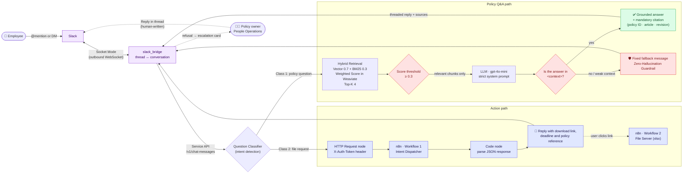

# Enterprise RAG Automation with Dify, n8n & Slack HITL

**A policy assistant that answers only from your internal rules, cites the clause it used, and refuses rather than guesses. It also runs the business process behind the question.**


> **Demo tenant:** *Demo Logistics Inc.*, a fictional logistics company, and its
> **Travel & Expense / HR Procedures policy (DL-HR-RG-2024-007, rev. 3)**.
> All companies, people, addresses and phone numbers in this repository are made up.

---

## Overview

Most "chat with your documents" bots fail enterprise review for the same two reasons:

1. **They improvise.** When the policy is silent, a general-purpose LLM fills the gap with plausible
   general knowledge ("Under labor law, you are typically entitled to…"). In HR, finance and
   compliance, a confident wrong answer costs more than no answer, because employees act on it.
2. **They cannot show their work.** An answer without a traceable source cannot be audited, so
   Legal and Internal Audit will not sign off on it.

This project is a reference architecture that treats both as hard requirements rather than
prompt-tuning afterthoughts:

| Enterprise requirement | How this architecture meets it |
|---|---|
| **No hallucinated policy** | Two independent guardrails: a retrieval score threshold filters noise, and a strict system prompt forces a fixed refusal whenever the retrieved context does not contain the answer. |
| **Auditability** | Every answer ends with a mandatory citation block (policy ID, chapter / article / clause, revision date). Amounts and deadlines are quoted verbatim. |
| **Data governance** | Fully self-hosted Dify + n8n on Docker. Retrieval ranking runs inside Weaviate, so the policy corpus and retrieved policy text go only to **OpenAI (embeddings + LLM)**. No third-party reranker ever sees employee questions or policy text. The Slack front end connects over an outbound WebSocket (Socket Mode), so **no port on the host is exposed to the internet**. |
| **Accountability** | Out-of-scope questions are escalated in Slack to a named human owner, who answers in the employee's thread with one click. The model never decides what the policy does not cover. |
| **Beyond Q&A** | Requests such as "send me the expense template" are classified as actions and executed through an authenticated n8n webhook. The chatbot becomes an automation front-end. |
| **Reproducibility** | The knowledge base and Chatflow are provisioned by script through Dify's API instead of by clicking through the admin UI, so every number below can be re-measured. |

### Measured, not asserted

The pipeline was first built and measured end to end on a Japanese-language edition of the same
policy (git tag [`v1-ja`](https://github.com/knmgn/RAG_with_Dify_Automation/tree/v1-ja)). The corpus, prompts and tests have since been
rewritten for a U.S. company in English. The English corpus will be re-measured with the same
scripts, and this table updated.

| Metric | `v1-ja` (measured) | English edition | How to reproduce |
|---|---|---|---|
| Retrieval **Recall@4** on the 10 design-doc test queries | **10/10 = 100%** | pending | `python3 scripts/measure_recall.py --threshold 0.3` |
| End-to-end tests (policy Q&A, refusal, file delivery via n8n) | **3/3 pass** | pending | `python3 scripts/test_e2e.py` |
| n8n connectivity chain (host → n8n, Dify → n8n, WF1, WF2) | **4/4 pass** | pending | `./docker/test/test_webhook.sh` |
| Top retrieval score, in-scope vs. out-of-scope queries | `0.36–0.64` vs. `0.21–0.38` | pending | `python3 scripts/measure_recall.py` |
| Slack bridge unit tests (question flow, escalation lifecycle, Dify client) | — | **31/31 pass** | `cd slack_bridge && python3 -m unittest discover -s tests` |

The score row matters. On `v1-ja` the two ranges **overlapped**, so a score threshold alone can
never be an anti-hallucination guardrail. That observation drives the two-layer design below.

---

## Architecture



**Deployment topology.** Everything runs on one Docker host. Dify (`api`, `worker`, `ssrf_proxy`)
and n8n share a private Docker network (`demo-rag-net`). Dify reaches n8n by service name
(`http://n8n_local:5678`), and outbound HTTP from Chatflows goes through Dify's squid SSRF proxy,
which is explicitly allow-listed for `n8n_local`. The browser downloads files through the published
host port, a deliberate "two URLs" design documented in [`docker/README.md`](./docker/README.md).
The Slack bridge joins the same network, calls Dify's Service API directly, and publishes no ports.
The Dify Web App remains available as a second channel.

---

## Key Features

### 🛡️ Zero-Hallucination Guardrails (strict fallback routing)
- **Layer 1, retrieval:** a score threshold drops low-relevance chunks before they reach the LLM. The
  value is **measured, not picked**: on `v1-ja`, `0.3` sat below every correct hit with margin while
  cutting 3 of 4 out-of-scope queries, and the commonly recommended `0.5` was rejected because it
  discarded most correct answers under Weighted Score. `measure_recall.py` reports the score
  distribution so the threshold can be re-derived for any corpus.
- **Layer 2, generation:** the system prompt forbids inference, general legal or tax commentary,
  hedging words ("probably", "generally") and invented article numbers. If `<context>` does not
  contain the answer, the model must return **one fixed fallback message, word for word**.
- Because the two layers fail independently, a borderline chunk that slips past the threshold still
  cannot produce an invented answer.

### 📑 Source Citation & Provenance Tracking
- Every answer uses a fixed three-block format: **Answer → Details → Source**.
- The Source block names the policy ID, the chapter / article / clause and the revision date.
- Amounts, deadlines and conditions must be quoted **verbatim** from the policy, for example
  `USD 100 per ride (tax and tip included)`.
- Knowledge chunks carry six metadata fields (`doc_id`, `doc_title`, `doc_version`, `last_revised`,
  `doc_type`, `category`) so provenance survives re-indexing when the policy is revised.

### 🔎 Hybrid Search (Vector + BM25)
- **Semantic (0.7) + keyword (0.3)** weighting. Vector search handles colloquial phrasing
  ("how much for a late-night taxi?"), and BM25 catches exact identifiers that embeddings miss:
  form numbers such as `F-021`, file names, policy codes.
- **Parent-Child chunking:** one child chunk per line (up to 400 characters) for precise matching,
  and parent chunks of up to 3,500 characters so each answer gets the whole article. Parent size is
  set from the corpus itself: a parent smaller than the longest article cuts it in half, and a query
  that matches one clause then comes back without the clause that answers it (found and fixed on
  `v1-ja`).
- **Weighted Score ranking runs inside Weaviate.** A hosted reranker was evaluated and dropped. It
  added a second data-egress vendor, gave no recall gain, and returned *zero results with no error*
  when rate-limited, which is a silent failure mode you do not want in production.

### 🤝 Human-in-the-Loop (HITL) Workflow Integration
- **Slack escalation loop** ([`slack_bridge/`](./slack_bridge/)): when the guardrail refuses, the
  bridge posts an escalation card to the policy owners' channel. **Reply in thread** opens a modal,
  and the owner's answer is posted in the employee's thread **under the owner's own Slack name and
  profile photo**, labelled as human-written. AI answers keep the bot icon, so anyone reading the
  thread can tell which answers came from the model and which from a person. **Mark resolved** closes the card without a reply. The first owner to act claims the
  card, so two people never answer the same question.
- **Honest hand-off:** the employee is told "a person will reply here" only if the card was actually
  posted. If escalation is off or fails, they still get the fixed refusal with the owner's contact
  details. Requests to bend the rules ("can you make an exception?") always go to a human.
- **Context per thread:** one Slack thread maps to one Dify conversation, so follow-ups keep their
  context, and each answer lists the retrieved articles with their relevance scores.
- **Action execution:** a Question Classifier separates *questions* from *requests*. File requests
  call an **authenticated n8n webhook** (shared-secret `X-Auth-Token`), which returns a structured
  payload (download URL, submission deadline, macro warning, policy reference) that Dify renders
  into the reply.
- The n8n side is a plain webhook contract, so it can be pointed at ticketing, approval flows or a
  chat platform without touching the Dify graph.

### ⚙️ Infrastructure as Code for the RAG layer
- `scripts/` provisions the knowledge base and the Chatflow through Dify's Console API, using only
  the Python standard library (no `pip install` required).
- The exported Chatflow DSL (`dify/chatflow_dsl.yaml`, secrets stripped) can be imported into any
  Dify instance.
- n8n workflow exports are sanitized by `scripts/export_n8n_workflows.py`, which strips the owner's
  e-mail address that `n8n export:workflow` embeds by default.

---

## Prompt Engineering (System Message)

This is the system prompt deployed by
[`scripts/provision_chatflow.py`](./scripts/provision_chatflow.py), verbatim. It shows how tightly
the model is constrained.

```text
# Role
You are "Demo-Logi-Bot", the internal policy assistant for Demo Logistics Inc.
You answer employee questions about travel, expenses and HR procedures accurately, based on the internal policy (DL-HR-RG-2024-007).

# Non-negotiable rules
1. Always base your answer on the knowledge inside the <context> tag (the policy text).
2. If <context> does not contain the answer, or its relevance is low, NEVER fill the gap with guesses, assumptions or general knowledge. Instead, reply with exactly this message:

   "No explicit provision covering your question was found in the internal policy (DL-HR-RG-2024-007). Please contact People Operations directly (ext. 1234 / people-ops@demo-logistics.example.com)."

3. Even when asked about general legal, tax or employment matters, use the message above unless the internal policy addresses the point directly. General explanations such as "Under the FLSA..." or "The IRS generally..." are prohibited.
4. Quote amounts, deadlines and conditions from <context> exactly as written, without rewording (e.g. write "USD 100 per ride (tax and tip included)" word for word).
5. If the user asks for an exception or a change to the rules (e.g. "Can you make an exception for me?"), state that you have no authority to decide and direct them to People Operations.

# Answer format (mandatory)
Structure every answer in these three blocks:

**Answer**
(A direct answer in 1-3 sentences. List any amounts, conditions and deadlines as bullet points.)

**Details**
(Supporting explanation based on the relevant article. Always mention prohibited cases or exceptions if there are any.)

**Source**
- Policy: Demo Logistics Inc. Travel, Expense Reimbursement and HR Procedures Policy (DL-HR-RG-2024-007)
- Section: Article X, Clause/Paragraph X (topic)
- Last revised: October 1, 2024 (Revision 3)

# Tone and style
- Polite, concise business English.
- No unnecessary preamble (such as "Thank you for your question").
- No emoji.

# Prohibited
- Amounts, deadlines, names or departments that are not grounded in the knowledge
- Reusing earlier answers instead of consulting the knowledge each time
- Hedging language such as "probably", "generally" or "I think"
- Inventing policy numbers or article numbers

# Input
User question: {{#sys.query#}}

Reference knowledge:
<context>
{{#context#}}
</context>
```

**Design notes**
- The fallback is a **single fixed string**, so a refusal is easy to test. `scripts/test_e2e.py`
  asks an out-of-scope question and asserts that the reply routes to People Operations and its
  extension. The Slack bridge detects the same string to trigger human escalation.
- The context placeholder is `{{#context#}}`. The design doc originally used `{{#context.result#}}`,
  which Dify never substitutes, so the model would have received a literal placeholder and
  answered with no knowledge at all. That is one of the **12 implementation pitfalls** documented in
  §4-8 of the design doc.

---

## Tech Stack

- **Orchestration / RAG:** Dify (Self-Hosted), Chatflow with Question Classifier, Knowledge Retrieval, LLM, HTTP Request and Code nodes
- **LLM:** OpenAI `gpt-4o-mini`
- **Embeddings:** OpenAI `text-embedding-3-large`
- **Vector store / search:** Weaviate, Hybrid Search (vector + BM25) with Weighted Score ranking
- **Workflow automation:** n8n (Webhook, Switch, Respond to Webhook, Read/Write Files from Disk)
- **Chat front end:** Slack Bolt for Python in Socket Mode, Block Kit (cards, buttons, modals), SQLite for thread and escalation state
- **Infrastructure:** Docker Compose, shared Docker network, squid SSRF proxy allow-listing
- **Tooling:** Python 3.10+ standard library (provisioning, recall measurement, E2E tests), `openpyxl` (template generator)
- **Security:** shared-secret webhook authentication, secrets kept in gitignored env files, SOPS config for encrypted secrets

---

## Quick Start / How to Run

### Prerequisites
- Docker with Compose v2 (4 GB RAM minimum, 8 GB recommended), ports `80` and `5678` free
- Tested on macOS and Linux
- Python 3.10+
- An OpenAI API key, registered in Dify under **Settings → Model Provider** after first login

### 1. Create the shared network and start Dify

```bash
docker network create demo-rag-net

git clone https://github.com/langgenius/dify.git ~/dify-local
cp docker/dify/docker-compose.override.yaml ~/dify-local/docker/
cd ~/dify-local/docker
cp .env.example .env          # see docker/dify.env.example for the values this demo uses
docker compose up -d          # first start pulls images and takes 5-10 minutes
```

### 2. Start n8n and import the workflows

```bash
cd <this-repo>
cp expense_template_v3.xlsx docker/n8n/templates/expense_template_v3.xlsx
xattr -c docker/n8n/templates/expense_template_v3.xlsx   # macOS only
cd docker/n8n && docker compose up -d
```

Import `docker/n8n/workflows/*.json` in the n8n UI (`http://localhost:5678`), create a
**Header Auth** credential named `X-Auth-Token` with a random secret, and activate both workflows.

### 3. Configure environment variables

```bash
cp scripts/.dify_admin.env.example scripts/.dify_admin.env
```

| Variable | Purpose |
|---|---|
| `DIFY_BASE_URL` | Dify front door, `http://localhost` by default |
| `DIFY_EMAIL` / `DIFY_PASSWORD` | Dify admin account used by the provisioning scripts |
| `N8N_WEBHOOK_TOKEN` | Shared secret sent from Dify to n8n. Leave blank to read it from the n8n container. |
| `N8N_INTENT_DISPATCHER_PATH` | Webhook path of Workflow 1 (Intent Dispatcher) |

`scripts/.dify_admin.env` is gitignored. No API keys are hard-coded anywhere in the repository.

### 4. Provision, measure, test

```bash
./docker/test/test_webhook.sh                       # n8n chain: 4/4 PASS
python3 scripts/provision_knowledge.py              # knowledge base + hybrid retrieval
python3 scripts/provision_chatflow.py               # Chatflow: import, publish, export DSL
python3 scripts/measure_recall.py --threshold 0.3   # Recall@4 (target >= 90%) and score distribution
python3 scripts/test_e2e.py                         # 3 end-to-end tests
```

Then open the published app in Dify and try:

| Ask | Expected behavior |
|---|---|
| "How much can I claim for a late-night ride home?" | "USD 100 per ride (tax and tip included)" quoted verbatim + citation to Article 5 |
| "What does federal law say about overtime pay?" | Fixed fallback message + People Operations contact |
| "Send me the expense report template." | n8n webhook fires, reply includes a working download link |

### 5. Connect Slack (optional)

Create the Slack app from [`slack_bridge/manifest.yaml`](./slack_bridge/manifest.yaml), fill in
`slack_bridge/.env` (bot token, app-level token, Dify app key, escalation channel ID), then:

```bash
cd slack_bridge && docker compose up -d --build
```

Step-by-step instructions are in [`slack_bridge/README.md`](./slack_bridge/README.md).

> **Multilingual by design.** The same stack runs on a Japanese corpus at tag
> [`v1-ja`](https://github.com/knmgn/RAG_with_Dify_Automation/tree/v1-ja). Localizing it means swapping the knowledge corpus and the system
> prompt, while the graph, classifier, webhook contract, guardrails and Slack loop stay unchanged.
> The language-specific traps found along the way (non-ASCII chunk delimiters, BM25 not tokenizing
> CJK text, RFC 5987 file names) are documented in §4-8 of the design doc.

---

## Repository Layout

| Path | Contents |
|---|---|
| `01_dummy_manual_demo_logistics.md` | Demo policy corpus (DL-HR-RG-2024-007) |
| `02_dify_chatflow_design.md` | Full design doc: prompt, classifier, retrieval tuning, n8n patterns, 12 documented implementation pitfalls |
| `03_operations_manual.md` | Operations runbook: re-embedding on policy revision, backup/restore, troubleshooting |
| `04_api_examples.md` | curl / Postman examples for integrating the bot into existing systems |
| `dify/chatflow_dsl.yaml` | Exported Chatflow DSL (secrets stripped) |
| `docker/` | Self-hosted stack: n8n compose, Dify override, workflows, connectivity test |
| `scripts/` | Provisioning, recall measurement, E2E tests, template generator, n8n export sanitizer |
| `slack_bridge/` | Slack front end: Socket Mode bridge, human escalation loop, Slack app manifest, unit tests |
| `demo/` | Bilingual captions for the 60-second demo video |

---

## Roadmap

- **Approval-gated actions:** route exception requests to a manager for one-click approval before
  any action runs.
- **Answer feedback loop:** collect 👍/👎 on Slack answers and feed low-rated questions back into
  the test set used by `measure_recall.py`.
- **Escalations as training data:** turn owner answers from the Slack loop into proposed policy
  amendments or FAQ entries, so the same question is covered next time.

---

*All data in this repository is fictional and was created for demonstration purposes.*
