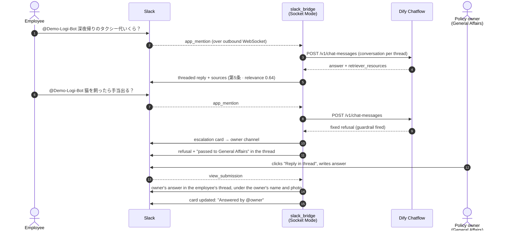

# Slack Front End — Socket Mode Bridge with Human Escalation

Puts Demo-Logi-Bot inside Slack. Employees ask in a channel (`@Demo-Logi-Bot …`) or in a direct
message, and the answer comes back in the thread with its sources. When the guardrail refuses a
question the policy does not cover, the question is escalated to a human owner, whose reply is
posted in the employee's thread.



## Why Socket Mode

The bridge opens an **outbound** WebSocket to Slack. No public Request URL, no ngrok tunnel and no
inbound firewall rule are needed, so the host keeps the §4-7 property that nothing on it is
reachable from the internet.

Data governance: questions and answers are now visible to Slack, because Slack is where the
conversation happens. Retrieval, the policy corpus, routing and the template file stay on the host,
and the policy text sent to the LLM still goes only to OpenAI.

## What it does

| Behavior | Detail |
|---|---|
| Channel questions | `@Demo-Logi-Bot <question>`. The reply goes in the thread |
| Direct messages | Any DM to the bot is a question |
| Follow-ups | One Slack thread = one Dify conversation, so "それって領収書いる？" (*do I need a receipt for that?*) keeps the context. Mapping persisted in SQLite |
| Sources | Each retrieved article is listed once with its relevance score. Never shown on a refusal |
| Progress | ⏳ reaction while Dify is answering, removed when done |
| Human escalation | Refusals post a card to `SLACK_ESCALATION_CHANNEL`. The employee is told a person will reply **only if the card was actually posted** |
| Owner reply | "Reply in thread" opens a modal. The answer is posted in the employee's thread **under the owner's Slack name and profile photo**, marked "not generated by AI". AI answers keep the bot icon, so the thread shows at a glance which answers came from a person. Slack still adds its APP badge, so the reply cannot pass for a message the owner typed directly. If the profile cannot be read or `chat:write.customize` is missing, the reply is posted under the bot's name with the same label |
| Double handling | The first owner to answer or resolve claims the card, and later clicks get "already handled". If posting the reply fails, the claim is released |
| Safety | Dify output is escaped before posting, so text like `<!channel>` in an answer cannot ping anyone |

File requests work unchanged: Dify routes them to n8n and the reply contains the download link.
The demo's link is `http://localhost:5678/...`, which only opens on the Docker host; in production
set n8n's `WEBHOOK_URL` to an internal DNS name (see [`../04_api_examples.md`](../04_api_examples.md) §9).

## Setup

1. **Create the Slack app.** In api.slack.com/apps choose Create New App → *From an app manifest*,
   then paste [`manifest.yaml`](./manifest.yaml).
2. **App-level token.** Basic Information → App-Level Tokens → generate one with
   `connections:write`. This is `SLACK_APP_TOKEN` (`xapp-…`).
3. **Install to workspace.** OAuth & Permissions → Install. The Bot User OAuth Token is
   `SLACK_BOT_TOKEN` (`xoxb-…`). If the app was installed before `chat:write.customize` and
   `users:read` were added to the manifest, update the manifest and **reinstall** to grant them.
4. **Escalation channel.** Create a channel for policy owners (e.g. `#policy-escalations`), run
   `/invite @Demo-Logi-Bot` in it, and copy its channel ID into `SLACK_ESCALATION_CHANNEL`.
5. **Dify API key.** In Dify open the app → API Access → API Key, or mint one from a script as shown
   in [`../04_api_examples.md`](../04_api_examples.md) §0. This is `DIFY_API_KEY`.
6. **Run it.**

   ```bash
   cd slack_bridge
   cp .env.example .env     # fill in the four values above
   docker compose up -d --build
   docker logs -f slack_bridge   # expect "⚡️ Bolt app is running!"
   ```

   Without Docker: `pip install -r requirements.txt`, set `DIFY_API_BASE=http://localhost/v1`
   and `BRIDGE_DB_PATH=./conversations.db`, then `python3 app.py`.

## Tests

```bash
cd slack_bridge
python3 -m unittest discover -s tests -v
```

29 unit tests cover the question flow, thread → conversation mapping, the escalation lifecycle
(card, modal, reply under the owner's identity and its fallbacks, resolve, double-claim, failure recovery), escaping, message splitting, config
validation, and the Dify client against a local HTTP server. They need no Slack workspace, no Dify
and no third-party packages.

## Files

| File | Purpose |
|---|---|
| `app.py` | Entry point: Bolt listeners wired to the handlers, Socket Mode |
| `handlers.py` | Question flow and escalation lifecycle (Bolt-independent, unit-tested) |
| `dify_client.py` | Dify Service API client (standard library only) |
| `formatting.py` | Block Kit builders, mrkdwn escaping, message splitting |
| `store.py` | SQLite state: thread → conversation, escalations |
| `messages.py` | Bridge UI strings in Japanese and English (`UI_LANGUAGE`) |
| `config.py` | Environment variable loading and validation |
| `manifest.yaml` | Slack app manifest (scopes, events, Socket Mode) |
| `docker-compose.yml`, `Dockerfile` | Container on `demo-rag-net`, no published ports |
